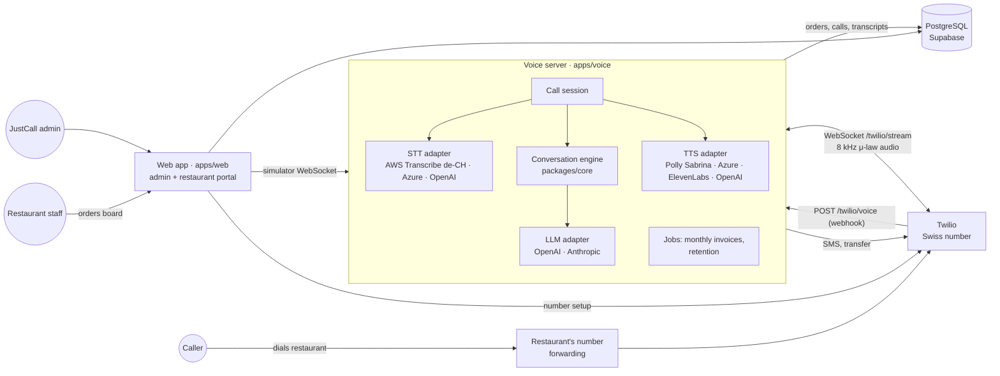

# Architecture

## Overview



## Repository layout

```
apps/
  web/        Next.js 16 (App Router): admin console, restaurant portal, API routes, PDFs
  voice/      Fastify server: Twilio webhooks + media streams, STT/TTS, call sessions, jobs
packages/
  core/       Pure TypeScript domain logic – no I/O: menu matching, cart & pricing, opening hours,
              safety guards, speech normalisation, invoice math, conversation engine, prompts,
              LLM adapters, evaluation harness
  db/         Drizzle ORM schema, SQL migrations, repositories (orders, invoices, menus …), seed
  services/   Server-side integrations shared by web and voice: Twilio, SMTP, SMS text,
              invoice PDF with Swiss QR-bill
docs/         Setup, deployment, architecture, conversation design, operations
```

`packages/core` has no dependencies on the database or HTTP, so the exact same conversation logic runs
in phone calls, in the browser simulator, in the terminal chat and in tests.

## A phone call, step by step

1. Twilio receives a call on a JustCall number and POSTs to `/twilio/voice` (signature validated).
2. The voice server looks up the restaurant by the dialled number, creates a `calls` row and answers
   with TwiML `<Connect><Stream>` containing a signed token.
3. Twilio opens the media WebSocket. The session loads the restaurant profile and menu (cached 30 s,
   invalidated instantly on edits), starts a streaming STT session with menu words as phrase hints, and
   plays the greeting.
4. Caller audio (20 ms μ-law frames) → STT. Final transcripts are joined until the caller pauses
   (`END_OF_TURN_MS`), then the **turn** runs:
   - deterministic safety guards (allergy, explicit owner request),
   - the LLM with tools; text is streamed and split into sentences,
   - each sentence → speech normalisation → TTS (cached) → audio frames back to Twilio, with marks to
     know when playback finished.
5. **Barge-in**: if the caller speaks while the assistant talks, playback is cleared and the rest of
   the answer is dropped.
6. Tools mutate the server-side order state; `confirm_order` persists the order (daily number), sends the
   SMS and emails the restaurant (optional). The orders board picks it up within ~4 s.
7. Transfers update the live call via Twilio REST to `<Dial>` the restaurant's transfer number; the
   result is reported to `/twilio/transfer-status`.
8. On hang-up the call row gets status, outcome, duration, token/audio usage and a summary; the
   transcript is stored as `call_events`.

Latency budget per answer (typical): end-of-speech detection 0.5–0.8 s + LLM first sentence 0.4–0.9 s +
TTS first audio 0.2–0.4 s ≈ **1.1–2.0 s**. Greeting and fixed phrases are cached and play instantly.

## Data model (main tables)

- `restaurants` – profile, bot settings, ordering rules, opening hours (JSON), payment, safety,
  billing terms.
- `menu_categories`, `menu_items` (with `aliases[]`, `code`, availability), `option_groups`,
  `options` (with aliases, surcharges, defaults), `menu_item_option_groups`.
- `phone_numbers` – Twilio numbers → restaurant.
- `calls`, `call_events` – every call with transcript, tool calls, usage.
- `orders`, `order_items`, `order_counters` – orders with price snapshots; numbering per local day.
- `invoices`, `invoice_lines`, `invoice_counters`, `platform_settings` – monthly billing.
- `user`, `session`, `account`, `verification` (better-auth), `memberships`, `invitations`.
- `audit_logs`, `job_runs`.

All money values are integer **Rappen**, percentages are **basis points**. All tables have row level
security enabled without policies, so Supabase's public REST API exposes nothing; the app connects
with a database role that bypasses RLS and enforces permissions in code.

## Security

- Passwords: scrypt (better-auth), invite-only accounts, rate-limited sign-in, secure cookies on HTTPS.
- Roles: platform **admin**; restaurant **owner** (operational settings, hours, invoices) and **staff**
  (orders board, sold-out toggles). Every server action checks access.
- Twilio webhooks: `X-Twilio-Signature` validation; media streams require an HMAC token minted per call.
- Simulator WebSocket: short-lived HMAC token from the web app.
- Internal endpoints (cache invalidation, voice preview) use `INTERNAL_API_SECRET`.
- Audit log for all administrative changes.
- No secrets in the browser; all third-party keys live on the servers.

## Extending

- **New speech provider**: implement `SttSession` (`apps/voice/src/stt/types.ts`) or `TtsProvider`
  (`apps/voice/src/tts/types.ts`) and add it to the factory.
- **New LLM provider**: implement `LlmClient` (`packages/core/src/llm/types.ts`).
- **New tool** for the assistant: add the spec to `tools.ts` and the handler in `engine.ts`; write a
  test in `engine.test.ts`.
- **Printer / POS integration**: hook into `CallPersistence.placeOrder` (voice) or poll
  `/api/r/<slug>/orders`.
